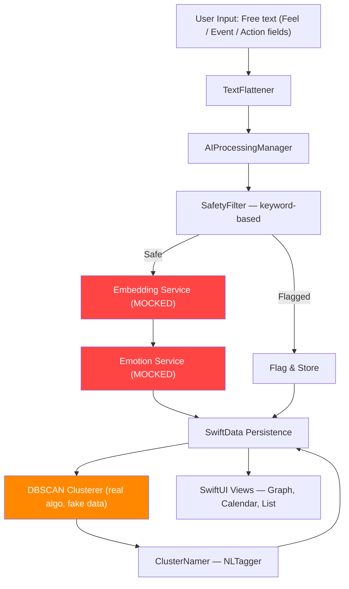

# GJournal — Bachelor Thesis Audit Overview

> **Context**: iOS micro-journaling app with on-device NLP. The AI pipeline is the principal thesis deliverable.  
> **Deadline**: ~2 weeks  
> **Target devices**: iPhone 11 (iOS 18), iPhone 14 Plus (iOS 26), iPhone 15 (iOS 26)  
> **Language**: English only  
> **No ML model exists yet** — the entire AI pipeline must be built from scratch.

---

## System Architecture

> [!IMPORTANT]
> **Emotion detection is background-only.**
> The `Feel` field in `AddEditBitView` is free-text input ("How are you feeling right now?").
> The user NEVER selects, tags, or confirms an emotion during entry creation.
> All 12-class emotion labels are computed entirely by `CoreMLEmotionService` after the entry is saved.
> Emotion UI (TopEmotionsView, EmotionDetailView, BitCard badge, CalendarView indicators)
> shows AI-inferred results — it is read-only output, never user input.

**Red** = completely mocked, must be built. **Orange** = real algorithm but running on garbage data.

---

## File-by-File Status

### Models Layer
| File | Status | Notes |
|:-----|:------:|:------|
| `Bit.swift` | 🟢 Ready | Relational SwiftData model. Embedding stored as JSON string — **should switch to binary `Data`** (see `04_UI_PERFORMANCE.md`) |
| `Cluster.swift` | 🟢 Ready | Relational model with `@Relationship` to Bit. Clean. |
| `ClusterAssignment.swift` | 🟢 Ready | Simple value type for DBSCAN output. |
| `Emotion.swift` | 🟡 Review | 12 emotions mix Ekman basics with complex affect states. Mapping from GoEmotions 28→12 needed (see `05_SCIENCE.md`) |
| `EmotionProbability.swift` | 🟢 Ready | Clean DTO for AI-detected probabilities. |
| `EmotionConfiguration.swift` | 🟢 Ready | Per-field emotion customization. Well-designed. |

### Services Layer (AI Pipeline — THE THESIS CORE)
| File | Status | Notes |
|:-----|:------:|:------|
| `AIProcessingManager.swift` | 🟢 Ready | Orchestration is solid. Pipeline steps are correctly ordered. Will work once real services are injected. |
| `AIServiceProtocol.swift` | 🟢 Ready | Clean protocol definitions with proper DI. |
| `ServiceContainer.swift` | 🔴 Critical | `makeProduction()` returns `makeMock()`. Must be wired to real Core ML services. |
| `MockAIService.swift` | 🔴 Placeholder | Random embeddings + keyword emotions. Produces meaningless data. |
| `DBSCANClusterer.swift` | 🟡 Needs optimization | Algorithm is correct but has O(N²·D) + O(N³) bottlenecks (see `02_DBSCAN.md`) |
| `ClusterNamer.swift` | 🟢 Ready | Uses Apple NLTagger for noun/verb extraction. Works well. |
| `SafetyFilter.swift` | 🟡 Acceptable | Keyword-based. Sufficient for personal use. Not ML-backed. |
| `TextFlattener.swift` | 🟡 Needs change | `[Title]` `[Feel]` bracket tags are invisible to pretrained BERT (see `01_AI_PIPELINE.md`) |

### Repository Layer
| File | Status | Notes |
|:-----|:------:|:------|
| `BaseJournalRepository.swift` | 🟢 Ready | Clean base class with search, filter, query operations. |
| `LocalJournalRepository.swift` | 🟢 Ready | CRUD + soft delete + AI trigger on save. Well-integrated. |
| `JournalRepositoryProtocol.swift` | 🟢 Ready | Protocol for DI. |
| `EmotionConfigurationManager.swift` | 🟢 Ready | Cached config with SwiftData persistence. |
| `AuthManager.swift` | 🟡 Security issue | Hash+salt stored in UserDefaults (plaintext). See `03_SECURITY.md` |

### Views Layer
| File | Status | Notes |
|:-----|:------:|:------|
| `ContentView.swift` | 🟢 Ready | Dashboard with calendar, emotions, navigation. |
| `AddEditBitView.swift` | 🟡 Minor | Uses deprecated `UIScreen.main.bounds`. Therapeutic wizard flow is polished. |
| `BitCard.swift` + `BitDetailView.swift` | 🟢 Ready | Well-designed card with micro-journal sections. |
| `BitsListView.swift` | 🟢 Ready | Full search/filter with cluster support. |
| `CalendarView.swift` | 🟢 Ready | Custom calendar with swipe navigation. |
| `ClusterGraphView.swift` | 🟡 Performance | Force-directed layout with SwiftUI views — will lag at 100+ nodes (see `04_UI_PERFORMANCE.md`) |
| `DayDetailView.swift` | 🟢 Ready | Simple day view. |
| `EmotionDetailView.swift` | 🟢 Ready | 30-day emotion drill-down. |
| `TopEmotionsView.swift` | 🟢 Ready | Dashboard emotion ranking cards. |
| `LoginView.swift` | 🟢 Ready | Name-only auth, privacy-first. Clean UI. |
| `BiometricLockView.swift` | 🟢 Ready | Face ID / passcode lock screen. |
| `MainAppView.swift` | 🟡 Wiring | Creates `ServiceContainer.makeMock()` — must switch to production. |
| `SettingsView.swift` | 🟡 Dev tool | "Generate Seed Data" button should be hidden or removed in production build. |

---

## What Must Be Built (Thesis Deliverables)

1. **Fine-tune & convert 3 embedding models** → `01_AI_PIPELINE.md`
2. **Fine-tune GoEmotions classifier** → `01_AI_PIPELINE.md`
3. **Design GoEmotions 28→12 label mapping** → `05_SCIENCE.md`
4. **Fix TextFlattener format** → `01_AI_PIPELINE.md`
5. **Optimize DBSCAN** (Accelerate + adaptive params) → `02_DBSCAN.md`
6. **Secure credentials** (Keychain + Data Protection) → `03_SECURITY.md`
7. **Fix UI bottlenecks** (graph rendering, deprecated APIs, binary storage) → `04_UI_PERFORMANCE.md`
8. **Benchmark 3 models** on iPhone 11 (latency, memory, quality) → `01_AI_PIPELINE.md`

---

## Document Index

| Doc | Content |
|:----|:--------|
| [`01_AI_PIPELINE.md`](./01_AI_PIPELINE.md) | ML model strategy, training plan, Core ML conversion, TextFlattener fix |
| [`02_DBSCAN.md`](./02_DBSCAN.md) | Algorithm optimization, Accelerate framework, adaptive parameters |
| [`03_SECURITY.md`](./03_SECURITY.md) | Keychain migration, Data Protection, threat model |
| [`04_UI_PERFORMANCE.md`](./04_UI_PERFORMANCE.md) | Graph rendering, deprecated APIs, binary embedding storage |
| [`05_SCIENCE.md`](./05_SCIENCE.md) | CBT analysis, emotion taxonomy, GoEmotions mapping, Plutchik alignment |
| [`06_TIMELINE.md`](./06_TIMELINE.md) | 2-week implementation schedule |
| [`07_FUTURE.md`](./07_FUTURE.md) | Behavioral tagging, dynamic notifications, sentiment-based recommendations |
| [`08_GRAPH_UI.md`](./08_GRAPH_UI.md) | ClusterGraphView Canvas migration, physics optimization, coordinate persistence |
| [`09_AI_PITFALLS.md`](./09_AI_PITFALLS.md) | Common AI coding mistakes — Claude Code implementation guardrails |
| [`10_IMPLEMENTATION_TASKS.md`](./10_IMPLEMENTATION_TASKS.md) | **Claude Code master task list — start here for autonomous execution** |

---

## 🤖 Claude Code Execution Instructions

**To run the full implementation autonomously**, point Claude Code at [`10_IMPLEMENTATION_TASKS.md`](./10_IMPLEMENTATION_TASKS.md) and say:

> *"Read docs/audit/10_IMPLEMENTATION_TASKS.md and execute all tasks in order. Read docs/audit/09_AI_PITFALLS.md first as a guardrail reference. The user's PC (RTX 2070) will be left running for training. Pause after Phase 1 to let the user copy .mlpackage files into Xcode."*

**Human checkpoints** (where you must intervene):
1. After Phase 1 → copy `.mlpackage` files and `vocab.txt` into the Xcode project
2. After Phase 2 → open Xcode, build, and verify compilation
3. After Phase 5 → run on physical devices for benchmarking

---

## 🎓 PhD Review — Academic Rigor Assessment

1. **Architecture is well-factored for a thesis**: The Repository pattern + Protocol-based DI + Service Container is a textbook clean architecture that will present well. Cite Martin's Clean Architecture (2017) or the VIPER pattern literature.
2. **The comparative study design** (3 embedding models benchmarked on the same dataset and device) is strong experimental methodology. Ensure you define **independent variables** (model architecture), **dependent variables** (latency, memory, silhouette score), and **controlled variables** (device, iOS version, dataset).
3. **Missing: Evaluation protocol**. Your thesis needs a formal evaluation section. Plan for: (a) quantitative benchmarks on devices, (b) qualitative assessment of clustering quality (do the clusters make semantic sense?), and (c) ideally a small user study (even N=1, yourself, with a structured self-report).
4. **Literature gap**: Cite Devlin et al. (2019) for BERT, Sun et al. (2020) for MobileBERT, Sanh et al. (2019) for DistilBERT, Ester et al. (1996) for DBSCAN.

## 🔴 Red-Hat Review — What Could Go Wrong

1. **2-week timeline is extremely tight**. The critical path (training → Core ML conversion → Swift tokenizer) has multiple failure points. If `coremltools` conversion fails for MobileBERT (known issues with some model architectures), you lose 1-2 days debugging. **Mitigation**: Start with DistilBERT (better coremltools support), have NLEmbedding as fallback.
2. **WordPiece tokenizer in Swift** is the single riskiest implementation task. Getting tokenization wrong means embeddings are garbage even with a perfect model. **Mitigation**: Use `swift-transformers` package or validate against Python tokenizer output exhaustively.
3. **The "Generate Seed Data" button** in Settings currently generates random embeddings. If accidentally left in the production build, it will corrupt real clustering data. **Mitigation**: Gate behind `#if DEBUG` preprocessor flag.
4. **Thesis scope creep**: The behavioral tagging feature (07_FUTURE.md) is exciting but must NOT be attempted in the 2-week window. It's post-thesis work.
