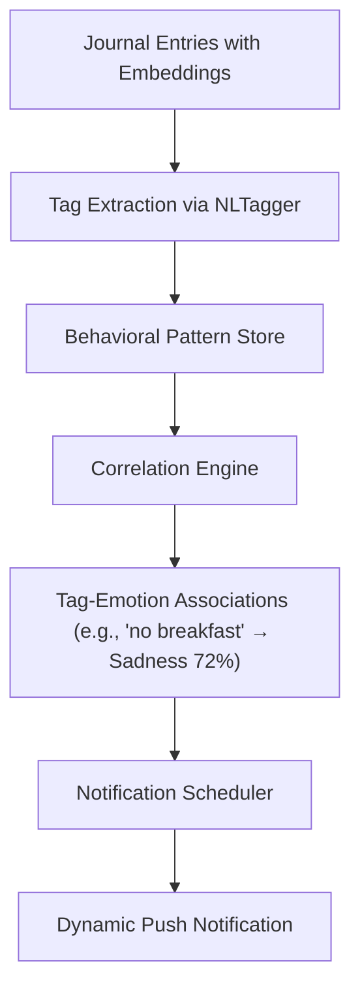

# Future Features — Behavioral Tagging & Dynamic Notifications

> These features are **post-thesis** enhancements. Documented here for architectural planning.

---

## 1. Behavioral Tagging (Contextual Labeling)

### Concept

Automatically extract behavioral patterns from journal entries by identifying **contextual tags** — recurring activities, situations, or habits that correlate with emotional states.

**Example**: Over 2 weeks, the model notices:
- Entries with `Sadness` or `Anxiety` frequently mention "skipped breakfast", "didn't sleep well", "stayed inside"
- Entries with `Joy` or `Excitement` frequently mention "went for a walk", "called a friend", "cooked dinner"

### Architecture



### Implementation Approach

1. **Tag Extraction**: Use Apple's `NLTagger` (already in the project for `ClusterNamer`) to extract noun phrases and verb phrases from entries. These become candidate behavioral tags.

2. **Correlation Store**: A new SwiftData model:

```swift
@Model
final class BehavioralTag {
    @Attribute(.unique) var id: UUID
    var tag: String                        // "skipped breakfast"
    var emotionCorrelations: [String: Float] // {"Sadness": 0.72, "Anxiety": 0.45}
    var occurrenceCount: Int
    var lastSeen: Date
    var confidence: Float                  // statistical confidence
}
```

3. **Correlation Engine**: For each tag, compute the conditional probability:

```
P(Emotion | Tag) = count(entries with Tag AND Emotion) / count(entries with Tag)
```

Only surface a correlation when:
- `occurrenceCount >= 5` (minimum sample size)
- `confidence >= 0.6` (at least 60% correlation)
- Tag appeared in the last 14 days (recency)

---

## 2. Dynamic Sentiment-Based Notifications

### Concept

When the model detects a negative emotional trend (e.g., 3 consecutive entries with `Sadness` or `Anxiety`), it can push a **proactive notification** suggesting a behavioral intervention based on the user's own positive patterns.

### Example Flow

```
1. User logs: "Feeling low today. Didn't sleep well. Stayed in all day."
   → Model tags: [poor_sleep, stayed_indoors]
   → Emotion: Sadness (intensity: 3)

2. Model checks last 7 days: Sadness trending ↑ (3 of 5 entries)

3. Model checks positive correlations:
   → "went for a walk" correlates with Joy (78%)
   → "called a friend" correlates with Gratitude (65%)

4. Notification (next morning):
   "You've been feeling a bit low lately. In the past, going for a walk 
    has helped lift your mood. Maybe give it a try today? 🌿"
```

### Technical Implementation

```swift
// UNUserNotificationCenter scheduling
func scheduleSentimentNotification(trend: EmotionTrend, suggestion: BehavioralTag) {
    let content = UNMutableNotificationContent()
    content.title = "A gentle nudge 💛"
    content.body = generateMessage(trend: trend, suggestion: suggestion)
    content.sound = .default
    
    // Schedule for next morning at 9 AM
    var dateComponents = DateComponents()
    dateComponents.hour = 9
    dateComponents.minute = 0
    
    let trigger = UNCalendarNotificationTrigger(
        dateMatching: dateComponents, repeats: false
    )
    
    let request = UNNotificationRequest(
        identifier: "sentiment-nudge-\(UUID().uuidString)",
        content: content, trigger: trigger
    )
    
    UNUserNotificationCenter.current().add(request)
}

private func generateMessage(trend: EmotionTrend, suggestion: BehavioralTag) -> String {
    let templates = [
        "You've been feeling \(trend.emotion.rawValue.lowercased()) lately. In the past, \(suggestion.tag) seemed to help. Worth a try? \(suggestion.tag.contains("walk") ? "🚶" : "💪")",
        "I noticed a pattern: when you \(suggestion.tag), you tend to feel more \(suggestion.positiveEmotion.rawValue.lowercased()). Just a thought for today ☀️",
    ]
    return templates.randomElement()!
}
```

### Privacy Considerations

- All pattern recognition runs **100% on-device**
- No data is ever sent to a server
- User must explicitly opt-in to notifications
- Notification content never reveals specific journal content — only behavioral suggestions
- User can view and delete all learned behavioral tags in Settings

### Data Requirements

This feature requires **minimum 30-50 journal entries** to have enough data for statistically meaningful correlations. It should be gated behind a threshold check.

---

## 3. Prerequisites for Implementation

Before building these features, the following thesis deliverables must be complete:

- [x] Real embedding model (for semantic tag extraction quality)
- [x] Real emotion classifier (for accurate emotion-tag correlation)
- [x] Optimized DBSCAN (behavioral patterns benefit from cluster context)
- [ ] Tag extraction pipeline (NLTagger-based)
- [ ] Correlation store (new SwiftData model)
- [ ] Notification permissions + scheduling
- [ ] Settings UI for opt-in/opt-out + tag management

---

## 🎓 PhD Review

1. **Behavioral tagging is a research contribution** beyond standard journaling apps. Frame it as: *"We propose an on-device behavioral pattern recognition system that identifies correlations between daily activities and emotional states, enabling personalized interventions without cloud processing."*
2. **The conditional probability approach** `P(Emotion | Tag)` is basic but defensible. For a more sophisticated approach, consider temporal correlations (e.g., does the behavior on Day N predict emotion on Day N+1?). This is a strong "future work" section for the thesis.
3. **This feature bridges NLP and Behavioral Psychology**. Cite the behavioral activation literature (Jacobson et al., 1996; Lejuez et al., 2001) for academic grounding.

## 🔴 Red-Hat Review

1. **Do NOT attempt this in the 2-week thesis window**. This feature requires: a working emotion classifier, a stable clustering pipeline, and enough accumulated user data (30+ entries). It's post-thesis work.
2. **Notification fatigue**: If the app sends recommendations too frequently, users will disable notifications entirely. Rate-limit to max 1 recommendation per day, 3 per week.
3. **Correlation ≠ Causation**: "User feels sad AND skipped breakfast" does not mean skipping breakfast *caused* sadness. The notification language must avoid causal claims. Use: *"In the past, you tended to feel better when..."* not *"Skipping breakfast makes you sad."*
4. **Privacy of recommendations**: Even though all processing is on-device, the notification content itself could be read on a locked screen. Ensure notification content is vague enough that passersby can't infer the user's emotional state. Use `content.interruptionLevel = .passive` and hide preview text.
