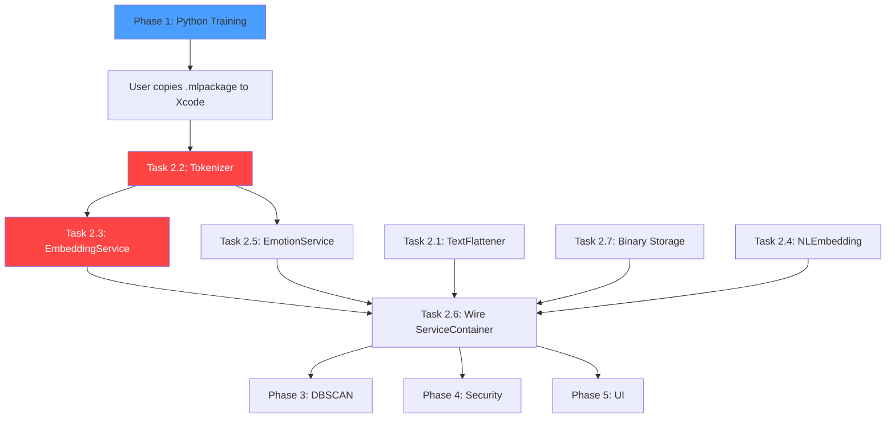

# Claude Code Master Task List — GJournal AI Pipeline Implementation

> **READ FIRST**: [09_AI_PITFALLS.md](./09_AI_PITFALLS.md) before writing ANY code.
> **Context**: Bachelor thesis iOS app. AI pipeline is the core deliverable. No ML model exists yet.
> **Workspace**: `/Users/constantin-alexandrudumitrascu/Desktop/Licenta/`
> **Target**: iPhone 11 (iOS 18), iPhone 14 Plus, iPhone 15 — English only

---

## Phase 1: Python Training Scripts (PC — RTX 2070 8GB)

### Task 1.1: Create training environment setup script

**File**: `ml/setup.sh`

```
Create a bash script that:
1. Creates a Python venv at ml/venv
2. pip installs: sentence-transformers==3.0.0, transformers, datasets, 
   coremltools, torch, scikit-learn, numpy, onnx
3. Prints GPU availability check (torch.cuda.is_available())
```

**Validation**: Script runs without errors. GPU detected.

### Task 1.2: Download and evaluate all-MiniLM-L6-v2 (SLOT 1)

**File**: `training/train_embedding_mobilebert.py` ✅ (script exists)

```
Key requirements (no training — download + eval only):
- Model: sentence-transformers/all-MiniLM-L6-v2
- Dataset: STS-B from HuggingFace datasets (glue/stsb)
- Framework: sentence-transformers
- NO fine-tuning — model is already pre-trained on 1B+ pairs
- Evaluator: EmbeddingSimilarityEvaluator on validation split
- Output dir: training/models/mobilebert-stsb/
- Print final Spearman correlation score
- Verify pooling config after save: pooling_mode_mean_tokens must be true
```

**Validation**: Spearman correlation > 0.75. Expected: ~0.8696.

### Task 1.3: Download and evaluate paraphrase-MiniLM-L6-v2 (SLOT 2)

**File**: `training/train_embedding_distilbert.py` ✅ (script exists)

```
Same structure as Task 1.2 but:
- Model: sentence-transformers/paraphrase-MiniLM-L6-v2
- Output dir: training/models/distilbert-stsb/
- NO fine-tuning — model is already pre-trained
```

**Validation**: Spearman correlation > 0.75. Expected: ~0.8695.

### Task 1.4: Create GoEmotions classifier training script

**File**: `ml/train_emotion_classifier.py`

```
Follow 01_AI_PIPELINE.md Section 3 and 05_SCIENCE.md Section 3.
Key requirements:
- Base: google/mobilebert-uncased (smaller model for mobile)
- Dataset: google-research-datasets/go_emotions (simplified split)
- Label mapping: Use GOEMOTION_TO_GJOURNAL from 05_SCIENCE.md
- 12 output classes matching Emotion.swift enum values
- Handle class imbalance with compute_class_weight('balanced')
- Training: 3 epochs, batch_size=32, fp16=True
- Evaluate: per-class F1, confusion matrix, overall accuracy
- Output dir: ml/models/emotion-classifier/
- Save classification report to ml/results/emotion_report.txt
- CRITICAL: GoEmotions is multi-label. For each example, if it has
  multiple labels, create duplicate training examples (one per label).
  Drop examples where ALL labels are 'neutral'.
```

**Validation**: Overall accuracy > 60%. Per-class F1 printed.

### Task 1.5: Create Core ML conversion script

**File**: `ml/convert_to_coreml.py`

```
Follow 01_AI_PIPELINE.md Section 4 and 09_AI_PITFALLS.md Section 3.
MUST convert 3 models:

1. all-MiniLM-L6-v2 (SLOT 1) → GJournalEmbeddingMiniLM.mlpackage
2. paraphrase-MiniLM-L6-v2 (SLOT 2) → GJournalEmbeddingParaphrase.mlpackage
3. Emotion classifier → GJournalEmotionClassifier.mlpackage

Key requirements per 09_AI_PITFALLS.md:
- Extract inner transformer from SentenceTransformer wrapper (Pitfall 3.3)
- Trace with BOTH input_ids AND attention_mask as tuple (Pitfall 3.1)
- Name outputs explicitly: "last_hidden_state" or "logits" (Pitfall 3.2)
- Fixed input shape: (1, 128) for both input_ids and attention_mask
- compute_precision=ct.precision.FLOAT16
- minimum_deployment_target=ct.target.iOS17
- compute_units=ct.ComputeUnit.ALL
- Output dir: ml/coreml_models/
- Also copy vocab.txt from each model's tokenizer to ml/coreml_models/

IMPORTANT: If all-MiniLM conversion fails, try convert_to="mlprogram".
If that also fails, log the error and continue with paraphrase-MiniLM only.
Both models share the same vocab.txt — copy ONE file named vocab_minilm.txt.
```

**Validation**: .mlpackage files created. Each < 100MB.

### Task 1.6: Create benchmark evaluation script

**File**: `ml/benchmark_embeddings.py`

```
Compare all 3 embedding approaches on STS-B test set:
1. all-MiniLM-L6-v2 (SLOT 1, contrastive pre-training)
2. paraphrase-MiniLM-L6-v2 (SLOT 2, paraphrase pre-training)
3. Apple NLEmbedding (OS baseline — no bundle cost)

Report:
- Spearman correlation per model
- Average inference time per sentence (CPU, 100 runs)
- Model size in MB
- Output to ml/results/embedding_benchmark.txt
```

---

## Phase 2: Swift Implementation (Mac — Xcode)

> **IMPORTANT**: Before starting Phase 2, the user must:
> 1. Copy ml/coreml_models/*.mlpackage into the Xcode project
> 2. Copy ml/coreml_models/vocab.txt into the Xcode project bundle
> 3. Add the .mlpackage files to the Xcode target

### Task 2.1: Fix TextFlattener — strip bracket tags

**File**: `GJournal/Services/TextFlattener.swift`

```
Per 01_AI_PIPELINE.md Section 5:
- Remove all [Title], [Feel], [Event], [Action] bracket tags
- Join fields with ". " (period + space) for natural sentence boundaries
- Keep trimming logic
- Both flatten() overloads must be updated
```

**Pitfall ref**: 09_AI_PITFALLS.md — BERT tokenizes brackets as sub-words.

### Task 2.2: Create WordPiece tokenizer in Swift

**File**: `GJournal/Services/WordPieceTokenizer.swift` (NEW)

```
Per 09_AI_PITFALLS.md Pitfall 2.1:
- Load vocab.txt from app bundle (one word per line, index = line number)
- Implement WordPiece tokenization (NOT whitespace splitting)
- Prepend [CLS] (token 101), append [SEP] (token 102)
- Pad to maxLength=128 with pad token (0)
- Generate attention_mask (1 for real tokens, 0 for padding)
- Return struct: TokenizerOutput { inputIDs: [Int32], attentionMask: [Int32] }
- Handle: lowercasing, unknown words → [UNK] (token 100)
- MUST handle ##subword continuation tokens
```

**Validation**: tokenize("I felt happy today") produces same IDs as Python tokenizer.

### Task 2.3: Create CoreMLEmbeddingService

**File**: `GJournal/Services/CoreMLEmbeddingService.swift` (NEW)

```
Implements EmbeddingServiceProtocol.
Per 09_AI_PITFALLS.md Pitfalls 2.2, 2.3, 2.4:
- Load .mlpackage model at init (lazy, MLModelConfiguration.computeUnits = .all)
- Use WordPieceTokenizer from Task 2.2
- Create MLMultiArray inputs with FIXED shape [1, 128] (Pitfall 2.2)
- Extract embedding using MEAN POOLING over non-padding tokens (Pitfall 2.3)
- NOT [CLS] token — must match sentence-transformers training
- L2-normalize the output vector (required for DBSCAN cosine distance)
- Run inference on background thread, return on caller's context
- Handle model loading failure gracefully (throw, don't crash)
```

### Task 2.4: Create NLEmbeddingService (Apple baseline)

**File**: `GJournal/Services/NLEmbeddingService.swift` (NEW)

```
Per 01_AI_PIPELINE.md Model C:
- Use NLEmbedding.sentenceEmbedding(for: .english)
- Handle nil case (model not available on device)
- Return [Float] from embedding.vector(for: text)
- Convert [Double] to [Float]
- L2-normalize output
```

### Task 2.5: Create CoreMLEmotionService (background inference — no UI during entry creation)

**File**: `GJournal/Services/CoreMLEmotionService.swift` (NEW)

```
Implements EmotionDetectionServiceProtocol.
- Load GJournalEmotionClassifier.mlpackage
- Tokenize input with WordPieceTokenizer
- Run prediction, extract logits output
- Apply softmax to get probabilities
- Map indices to Emotion enum (same order as TARGET_LABELS in training)
- Return [EmotionProbability] sorted by probability descending
```

### Task 2.6: Wire ServiceContainer

**File**: `GJournal/Services/ServiceContainer.swift`

```
Update makeProduction() to return real services:
- embeddingService: CoreMLEmbeddingService(modelName: "GJournalEmbeddingMiniLM")
- emotionService: CoreMLEmotionService(modelName: "GJournalEmotionClassifier")
- clusteringService: DBSCANClusterer(epsilon: 0.3, minPoints: 3)
- safetyFilter: SafetyFilter()

Keep makeMock() for testing.
Fix MainAppView.swift double instantiation (04_UI_PERFORMANCE.md Section 5).
```

### Task 2.7: Switch embedding storage to binary Data

**File**: `GJournal/Models/Bit.swift`

```
Per 04_UI_PERFORMANCE.md Section 3:
- Replace embeddingJSON: String? with embeddingData: Data?
- Add computed property embedding: [Float]? using withUnsafeBytes
- Same for emotionProbabilitiesJSON → emotionProbabilitiesData
- Use safe encode/decode per 09_AI_PITFALLS.md Pitfall 6.1
- Update ALL references in AIProcessingManager, DBSCANClusterer, etc.
```

**Pitfall ref**: 09_AI_PITFALLS.md Pitfall 6.2 — new fields MUST be Optional or have defaults.

---

## Phase 3: DBSCAN Optimization

### Task 3.1: Optimize DBSCANClusterer with Accelerate

**File**: `GJournal/Services/DBSCANClusterer.swift`

```
Per 02_DBSCAN.md Section 2:
- Import Accelerate
- Replace scalar cosineDistance with vDSP_dotpr on pre-normalized vectors
- Pre-normalize all vectors once using vDSP_svesq + vDSP_vsdiv
- Replace seedSet Array.contains with Set<Int> for O(1) lookup
- Add guard for entries.count < minPoints (Pitfall 4.2)
```

### Task 3.2: Add adaptive epsilon estimation

**File**: `GJournal/Services/DBSCANClusterer.swift`

```
Per 02_DBSCAN.md Section 3:
- Add static func estimateEpsilon(distances:minPoints:) -> Double
- Implement k-distance heuristic (90th percentile of k-nearest distances)
- Add static func silhouetteScore(labels:distances:) -> Double
```

### Task 3.3: Add periodic recalibration to AIProcessingManager

**File**: `GJournal/Services/AIProcessingManager.swift`

```
Per 02_DBSCAN.md Section 3 recalibration strategy:
- Track entriesSinceLastCalibration counter
- Every 10 new entries, recalculate epsilon using estimateEpsilon()
- Log silhouette score for debugging/benchmarking
```

---

## Phase 4: Security Hardening

### Task 4.1: Migrate credentials to Keychain

**File**: `GJournal/GJournal/Repository/AuthManager.swift`

```
Per 03_SECURITY.md Section 2:
- Add storeCredentialInKeychain(key:value:) helper
- Add readCredentialFromKeychain(key:) helper
- Use kSecAttrAccessibleWhenUnlockedThisDeviceOnly
- Move password_hash and password_salt reads/writes to Keychain
- Delete old UserDefaults entries after migration
- Keep user_name, user_registered, biometric_enabled in UserDefaults
```

### Task 4.2: Enable Data Protection on SwiftData

**File**: `GJournal/GJournalApp.swift`

```
Per 03_SECURITY.md Section 3:
- After ModelContainer creation, set FileProtectionType.completeUnlessOpen
- Register ALL model types: Bit.self, Cluster.self, EmotionConfiguration.self
  (fixes 04_UI_PERFORMANCE.md Section 4 bug)
```

### Task 4.3: Hide dev tools in production

**File**: `GJournal/GJournal/Views/SettingsView.swift`

```
Wrap "Generate Seed Data" button in #if DEBUG conditional compilation.
```

---

## Phase 5: UI Cleanup

> [!WARNING]
> **Do NOT add emotion-selection UI to the entry creation flow.**
> `AddEditBitView.swift` must remain a pure free-text form.
> No emotion pickers, no emotion tag chips, no inline emotion feedback during writing.
> Emotion labels are AI outputs — display them only in read-only analytics views
> (TopEmotionsView, EmotionDetailView, BitCard badge, CalendarView indicators).

### Task 5.1: Fix deprecated UIScreen.main.bounds

**Files**: `GJournal/Views/AddEditBitView.swift`, `GJournal/Views/ClusterGraphView.swift`

```
Per 04_UI_PERFORMANCE.md Section 2:
- Replace UIScreen.main.bounds.width with GeometryReader-provided size
- In AddEditBitView: pass geometry width for slide animation offset
- In ClusterGraphView: pass geometry size for graph building
- Replace UIApplication.shared.connectedScenes with GeometryReader
```

### Task 5.2: Optimize ClusterGraphView rendering

```
Per 08_GRAPH_UI.md — implement Canvas-based rendering:
- Replace ForEach nodeView rendering with single Canvas
- Implement manual hit-testing for tap/drag gestures  
- Add distance cutoff for physics repulsion (300px)
- Add convergence detection (stop timer when maxMovement < 0.5)
- Add coordinate persistence (graphX/graphY on Bit model)

This is the LARGEST single task. Reference 08_GRAPH_UI.md for full implementation.
```

---

## Execution Order & Dependencies



**Blue** = runs on PC. **Red** = highest risk tasks (tokenizer + Core ML integration).

---

## What Claude Code Can Do Autonomously

| Task | Autonomous? | Notes |
|:-----|:-----------:|:------|
| Write Python scripts | ✅ Yes | All ml/*.py files |
| Run Python training | ✅ Yes | `python ml/train_*.py` (leave PC running) |
| Write Swift files | ✅ Yes | All new/modified .swift files |
| Modify existing Swift | ✅ Yes | TextFlattener, Bit, ServiceContainer, etc. |
| Build Xcode project | ❌ No | User must open Xcode and build |
| Copy .mlpackage to Xcode | ❌ No | User must drag files into Xcode project |
| Run on physical iPhone | ❌ No | User must connect device and run |
| Run Core ML conversion | ✅ Yes | `python ml/convert_to_coreml.py` on Mac |

## Files Created/Modified Summary

### New Files
```
ml/setup.sh
ml/train_embedding_mobilebert.py
ml/train_embedding_distilbert.py
ml/train_emotion_classifier.py
ml/convert_to_coreml.py
ml/benchmark_embeddings.py
GJournal/Services/WordPieceTokenizer.swift
GJournal/Services/CoreMLEmbeddingService.swift
GJournal/Services/NLEmbeddingService.swift
GJournal/Services/CoreMLEmotionService.swift
```

### Modified Files
```
GJournal/Services/TextFlattener.swift
GJournal/Services/ServiceContainer.swift
GJournal/Services/DBSCANClusterer.swift
GJournal/Services/AIProcessingManager.swift
GJournal/Models/Bit.swift
GJournal/GJournalApp.swift
GJournal/GJournal/Repository/AuthManager.swift
GJournal/GJournal/Views/SettingsView.swift
GJournal/GJournal/Views/MainAppView.swift
GJournal/Views/AddEditBitView.swift
GJournal/Views/ClusterGraphView.swift
```
